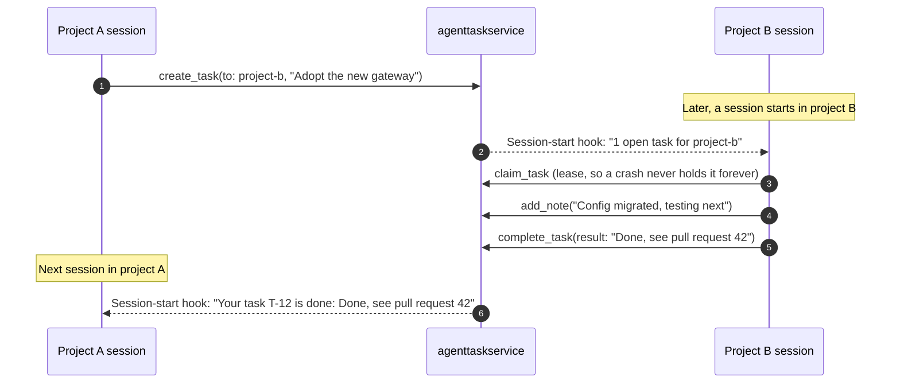
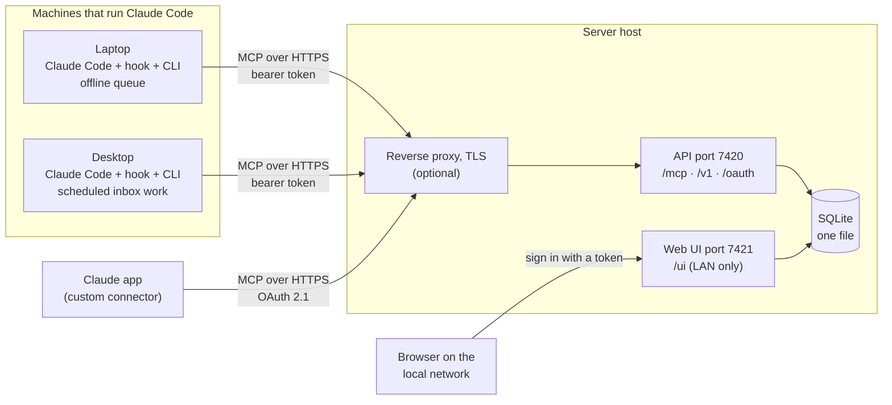
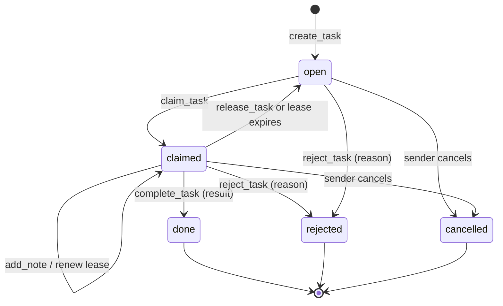
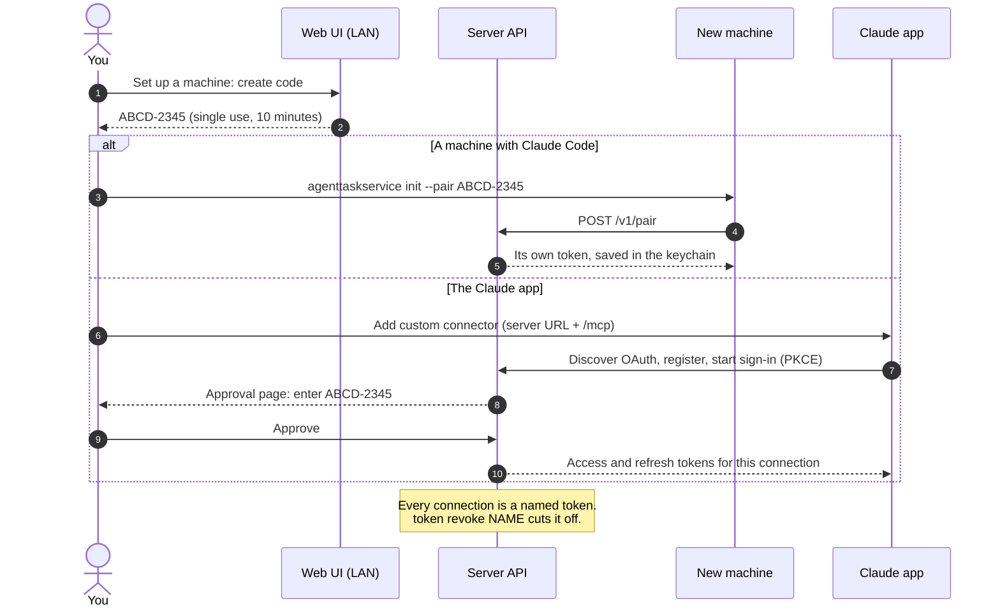

<!-- Copyright (c) 2026 OneVector LLC -->
# agenttaskservice

A small task service that lets AI agent projects hand TODOs to each other.

One project creates a task ("adopt the new gateway"), another project's next
session sees it, claims it, works it and completes it with a result. Every
machine talks to one server, so there is nothing to sync and nothing to merge.
Clients use it through [MCP](https://modelcontextprotocol.io) (Streamable HTTP),
so Claude Code and other MCP clients can call it directly.

- One process, one SQLite file.
- Claims with leases: a crashed session never holds a task forever.
- Version checks on every write: two sessions can't overwrite each other.
- Append-only history of every change.
- Runs on its own (optional built-in TLS) or behind any reverse proxy.

## How it works

### The idea

Projects don't share files to pass work along: they share one small server.
A task is a message with a lifecycle. One project's session sends it, and the other
project's session picks it up the next time it starts. The result comes back the same way.



### Topology

One server holds every task. Machines that run Claude Code talk to its API with their
own tokens. The Claude app connects to the same API with OAuth. The web UI has its own
port, meant for the local network only, so a proxy that forwards only the API can't expose it.



- **Single source of truth.** One process and one SQLite file. Nothing to sync between machines, nothing to merge.
- **Every write is safe.** Each task has a version. A write based on a stale version is refused, so two sessions can't overwrite each other.
- **Nothing gets stuck.** A claim is a lease. If a session crashes, the lease runs out and the task is open again.
- **Offline is fine.** When the server can't be reached, the CLI queues changes and sends them at the next session start.
- **History is kept.** Every change is appended to the task's history, which can't be edited.

### Task lifecycle



### Connecting a machine or the Claude app

Nobody copies a token between machines. You create a short one-time pairing code
(in the web UI or with `token pair`), and the new machine or the Claude app trades it
for its own credentials. Each connection gets its own token name, so you can revoke
any one of them without affecting the others.



## Quick start

Requires Node.js 22 or newer.

```sh
npx agenttaskservice serve
```

The first start creates an `admin` token and saves it to `admin-token` in the
data directory, readable only by you (it is never printed, so it can't end up in
service logs). Copy it somewhere safe and delete the file. If every token is later revoked,
the next start creates a new admin token the same way.
Create one token per machine or client:

```sh
npx agenttaskservice token add laptop
```

Then set up each machine that runs Claude Code (see [Client setup](#client-setup)):

```sh
npm install -g agenttaskservice
AGENTTASK_TOKEN=<token> agenttaskservice init --url https://tasks.example.com
```

Register the projects that receive tasks, so others can find them:

```sh
npx agenttaskservice project add project-b --name "Project B" --description "Builds the video pipeline"
```

## MCP tools

| Tool | What it does |
| --- | --- |
| `create_task` | Hand a TODO to another project (`client_key` makes retries safe) |
| `list_my_tasks` | Inbox: tasks sent to your project |
| `list_sent_tasks` | Outbox: tasks your project sent, with status |
| `get_task` | One task with its full history |
| `claim_task` | Take a task; the claim expires after `lease_hours` unless renewed |
| `add_note` | Progress note; renews your claim |
| `release_task` | Give a claimed task back |
| `complete_task` | Mark done with a result |
| `reject_task` | Receiver hands a task back; sender cancels its own |
| `list_projects` | Known projects and what they do |

Each tool takes `project`, the caller's project id (lowercase letters, digits,
`.`, `_`, `-`). Claim, release, complete and reject require `version` from the
task you last read, so nobody's change is overwritten. While a claim is live,
only its holder (the same token, and the same `session` label if one was used)
can complete, release or reject the task, and only the holder's notes renew the
lease. The sending project can always cancel its own task.

## HTTP endpoints

| Endpoint | Auth | Purpose |
| --- | --- | --- |
| `POST /mcp` | Bearer token | MCP, stateless Streamable HTTP |
| `GET /v1/inbox?project=<id>` | Bearer token | Open tasks for a project, plus the project's sent tasks that finished since it last asked (each shown once). Meant for session-start hooks. |
| `POST /v1/pair` | pairing code | Trade a one-time pairing code (`{"code": "...", "name": "..."}`) for a new token. Wrong codes are rate limited. |
| `GET /health` | none | Liveness check |
| `GET /.well-known/oauth-protected-resource`, `GET /.well-known/oauth-authorization-server` | none | OAuth metadata (only with `server.public_url`) |
| `POST /oauth/register`, `GET/POST /oauth/authorize`, `POST /oauth/token`, `POST /oauth/revoke` | see [Claude app connector](#claude-app-connector) | OAuth 2.1 for MCP clients |

## Configuration

Settings come from built-in defaults, then a TOML file, then environment variables.
The file is `$XDG_CONFIG_HOME/agenttaskservice/server.toml` (or `--config <path>`,
or `AGENTTASK_CONFIG`). See [`examples/server.toml`](examples/server.toml).

| Setting | Env var | Default |
| --- | --- | --- |
| `server.host` | `AGENTTASK_HOST` | `127.0.0.1` |
| `server.port` | `AGENTTASK_PORT` | `7420` |
| `tls.cert`, `tls.key` | `AGENTTASK_TLS_CERT`, `AGENTTASK_TLS_KEY` | unset (plain HTTP) |
| `storage.data_dir` | `AGENTTASK_DATA_DIR` | `~/.local/share/agenttaskservice` (Linux), `~/Library/Application Support/agenttaskservice` (macOS) |
| `tasks.lease_hours` | `AGENTTASK_LEASE_HOURS` | `4` (max 720) |
| `server.max_body_bytes` | | `1000000` |
| `server.public_url` | `AGENTTASK_PUBLIC_URL` | unset; the server's public https origin. Turns on OAuth for the Claude app |
| `server.trust_proxy` | `AGENTTASK_TRUST_PROXY` | `false`; set it when a reverse proxy on the same host adds `X-Forwarded-For` (recommended behind a proxy), so rate limits apply per client |
| `ui.enabled` | `AGENTTASK_UI_ENABLED` | `false` |
| `ui.host`, `ui.port` | `AGENTTASK_UI_HOST`, `AGENTTASK_UI_PORT` | `127.0.0.1`, `7421` |
| `ui.api_url` | `AGENTTASK_UI_API_URL` | unset; the API URL that the setup guide puts in its commands |
| `ui.repo_url` | `AGENTTASK_UI_REPO_URL` | unset; the `git clone` URL that the setup guide shows |

### Two ways to run it

- **Standalone:** set `server.host` to a LAN address and `tls.cert` / `tls.key`
  to a certificate. The server warns if it listens beyond loopback without TLS.
- **Behind a reverse proxy** (Caddy, nginx, Traefik or similar): keep the default
  loopback address and let the proxy terminate TLS. Auth stays on in the service
  either way.

Example service units are in [`examples/`](examples/).

## Web UI

With `ui.enabled = true`, `serve` also starts a small web UI on its own port
(`ui.host` / `ui.port`). It is meant for your local network: set `ui.host` to the
server's LAN address and do not route that port through a public proxy. The API
port never serves the UI, so a proxy that forwards only the API cannot expose it.

- **Sign in** with any active token. The browser gets an HttpOnly, SameSite=Strict
  session cookie for 12 hours (Secure when the server uses TLS). Every form has a
  CSRF token, and failed sign-ins are rate limited.
- **Projects and tasks:** open and in-progress counts per project, each project's
  received and sent tasks, and each task's details and history. Pages are plain
  HTML with a strict Content-Security-Policy and no JavaScript.
- **Set up a machine** (`/ui/setup`): a step-by-step guide that creates a pairing
  code, shows the exact `init` command to run on the new machine, and lists the
  connected machines with when each was last seen.

### Pairing a new machine

A pairing code saves copying a token between machines. Create one in the UI or with
`agenttaskservice token pair [--name <machine>]` on the server. It works once, within
10 minutes. On the new machine:

```sh
agenttaskservice init --url https://tasks.example.com --pair ABCD-2345 --name laptop --rule
```

`init` trades the code for the machine's own token only after you confirm the
changes, so a `--dry-run` or a "no" leaves the code unused. The server stores only
a hash of each code.

Wrong codes are rate limited: 10 failures per client in 10 minutes, and 100 in
total. Behind a reverse proxy every request seems to come from the proxy, so
without `server.trust_proxy` only the total limit applies (one client's mistakes
can't lock everyone out). Revoking a token also signs out its browser sessions.

## Claude app connector

The Claude app (web, desktop and mobile) can use the task tools as a custom
connector. It signs in with OAuth 2.1, as the MCP authorization spec describes:
the server publishes OAuth metadata, the app registers itself, and you approve it
once with a pairing code. No password is stored anywhere.

1. Set `server.public_url` to the server's public https address (the one that
   reaches the API, for example `https://tasks.example.com`) and restart.
2. In the Claude app, open **Settings → Connectors → Add custom connector**. Give
   it a name and the URL `https://tasks.example.com/mcp`, then select **Connect**.
3. A page from your server opens, showing the app's name and where it will send
   you back. Create a pairing code in the web UI (**Set up a machine**) or with
   `agenttaskservice token pair`, enter it, and select **Approve**.
4. The connection gets its own token name (for example `claude`), shown in
   `token list`. `agenttaskservice token revoke <name>` disconnects the app.

Details: authorization code with PKCE (S256) only, public clients only, redirect
URIs must be https (or http on localhost) and match exactly. Access tokens last an
hour; refresh tokens last 30 days and rotate on each use, and reusing an old one
ends the connection. Codes and tokens are stored hashed. Since anyone can register a
client, a bad authorization request shows an error page on the server instead of
redirecting back to the client with `error` (RFC 6749 4.1.2.1), so the server can't be
used as an open redirector. Wrong pairing codes on the
approval page count toward the same rate limit as `POST /v1/pair`.

## Client setup

`agenttaskservice init` connects one machine to a server. It checks the server and
the token, lists what it will change, and asks before writing anything:

- stores the token in the macOS Keychain, the Linux secret service (`secret-tool`),
  or a file readable only by you, in that order of preference;
- writes `$XDG_CONFIG_HOME/agenttaskservice/client.toml` (server URL, optional
  workspace root; never the token);
- registers the MCP server with Claude Code at user scope. Claude Code gets the
  token from `agenttaskservice auth-header`, so it is not stored in Claude Code's config;
- adds a `SessionStart` hook to `~/.claude/settings.json`, keeping your other hooks;
- with `--rule`, adds a short task rule to `~/.claude/CLAUDE.md` (otherwise it prints it).

Use `--dry-run` to only list the changes, `--yes` to skip the prompt. Running it
again is safe: it changes only what differs. Without a token in `AGENTTASK_TOKEN`
it asks for one without echoing it. The client refuses plain `http://` to anything
but loopback, since that sends the token in clear text; `--insecure` overrides this.

At every session start the hook prints the project's open tasks and the tasks it
sent that have finished, so Claude sees them before you type. It waits at most
2 seconds and never blocks the session: if the server is down it prints one line.

**Which project am I?** The first match wins:

1. `AGENTTASK_PROJECT` environment variable
2. a `.agenttask` file with `project = "<id>"`, in the folder or a parent up to the git root
3. `workspace_root` in `client.toml`: the first folder under it
4. the git remote `origin` repository name
5. the git root folder name, then the current folder name

`agenttaskservice whoami` shows the result.

**Inboxes this machine handles:** `init --watch <project>` (repeatable) makes the
hook also list another project's open tasks on this machine, for example a shared
inbox that only one machine processes.

**Scheduled processing:** for an inbox no one opens Claude Code for, `init --work <project>`
schedules `agenttaskservice work --inbox <project>`, every 60 minutes by default
(`--every <minutes>`; `--every 0` removes the job). It uses launchd on macOS and a
systemd user timer on Linux, and logs to `$XDG_STATE_HOME/agenttaskservice/work-<project>.log`.
Each run lists the inbox first and starts Claude Code headless (`claude -p`) only when
there is something to do, in `--work-dir` (default: the current folder). Task text comes
from other machines, so that session is boxed in: only file read and edit tools exist (no
shell, web or subagents), they are approved only inside the work folder, your user-level
Claude Code settings are not loaded, the only MCP server is this one, and it cannot create
new tasks. Claude Code's hooks are off for that run, and it can never write files that would
run commands later (`.claude/`, `settings*.json`, `.mcp.json`, `.git/`). Claude Code versions
with `--restricted` get that mode too. The work folder can't be your home folder or hold
Claude Code's config folder. Claude claims each task and either
completes it, or, when the request is unclear or conflicts with what is there, adds a note
starting `needs-owner:` and leaves it open; later runs skip it until someone replies.
Put inbox-specific instructions in a file and pass it with `--work-prompt <file>`.
Runs never overlap.

**Offline:** when the server can't be reached, `agenttaskservice task create|note|complete|reject`
queue the change in `$XDG_STATE_HOME/agenttaskservice/outbox.jsonl`. `agenttaskservice flush`
or the next session start sends it. A change the server refuses on replay is reported
and dropped. A queued complete, reject or claim given without `--version` is applied only
if nobody else changed the task after it was queued.

## CLI

```text
agenttaskservice serve
agenttaskservice token add <name> | token pair [--name N] | token list | token revoke <name>
agenttaskservice project add <id> [--name N] [--description D] [--alias A ...]
agenttaskservice project list

agenttaskservice init [--url U] [--pair CODE [--name N]] [--workspace-root D] [--watch P]... [--rule] [--insecure] [--yes] [--dry-run]
                      [--work P [--every MIN] [--work-dir D] [--work-prompt F]]
agenttaskservice whoami | flush | auth-header | hook session-start
agenttaskservice work --inbox P [--prompt-file F] [--dir D] [--dry-run]
agenttaskservice task create --to P --title T [--body B|-] [--priority 1|2|3]
agenttaskservice task list [--sent] | show <id> | claim <id> | note <id> <text>
agenttaskservice task complete <id> --result R | reject <id> --reason R
```

Task commands accept `--project P`. Without `--version`, complete, reject and claim
act on the task as it is when the command is sent (if queued, see Offline above).

| Client env var | Purpose |
| --- | --- |
| `AGENTTASK_URL` | Server URL (overrides `client.toml`) |
| `AGENTTASK_TOKEN` | Token (overrides the stored one) |
| `AGENTTASK_PROJECT` | Project id for this shell |
| `AGENTTASK_WORKSPACE_ROOT` | Workspace root (overrides `client.toml`) |
| `AGENTTASK_TOKEN_STORE` | `keychain`, `secret-tool` or `file` |
| `AGENTTASK_CLIENT_CONFIG` | Path to `client.toml` |
| `AGENTTASK_ALLOW_INSECURE_HTTP` | `1` allows plain http to a non-loopback server |

## Development

```sh
npm install
npm run check   # typecheck, tests, sanitize
```

`npm run sanitize` fails on home-directory paths, real email addresses, private
IP addresses, keys and tokens in tracked files. Put extra private strings
(one per line) in an untracked `.sanitize-denylist` file to have them checked too.

## License

MIT. See [LICENSE](LICENSE).
